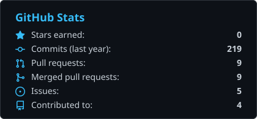
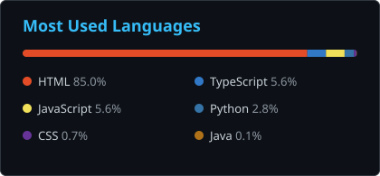

<!-- Animated header -->

  

  
  
  
  
  

### 👋 About Me

3rd-year **Computer Engineering** student at **Chitralada Technology Institute (CDTI)**, Bangkok. I work across AI backends, embedded sensing, and IoT firmware — and I only list the parts I built myself.

- 🥈 **TGR2026 — 1st Runner-up, national level:** My team placed 2nd of 56 teams (86.46/100) at TESA Top Gun Rally #20. My part was Track 1: an ESP32 sensor node that measures coffee-bean moisture from under 10 discrete parts (calibration **R² = 0.996**) and publishes JSON over MQTT.
- 🧠 **AI inference server:** Built Node 4 of *LUMA*, a 4-node distributed image-generation platform — a FastAPI server running Stable Diffusion on an RTX 3070 8GB with a FIFO queue, GPU-memory guard, async webhooks, and **17/17** passing Pytest tests.
- 📡 **Embedded & IoT:** Co-wrote the ESP32-S3 touchscreen firmware for *LoRaFarm Control* (**Honorable Mention, STI Inventions Contest 2026**).
- 🔬 **Research:** Research & Information Analysis for *FutureMe AI* — psychometric groundwork (Holland RIASEC, Bandura self-efficacy) and a multi-layer scoring framework.

---

### 🚀 Featured Projects

| Project | What I did | Stack |
| :--- | :--- | :--- |
| ☕ **TGR2026 Coffee AIoT** *(private repo)* | **Track 1 owner.** ESP32 moisture & capacitance sensing node with oversampling + trimmed-mean + EMA filtering, auto-fit calibration, and MQTT telemetry. **Team: 1st Runner-up, TESA Top Gun Rally #20** | `C++` `ESP32` `ADC/PWM` `MQTT` |
| 🎨 **[LUMA](https://github.com/Pongkarm/Project_Luma_PKW)** | **Node 4 — AI inference server** in a 4-person team: FastAPI + Stable Diffusion Forge on CUDA, FIFO queue, VRAM guard, WebP output, async webhook results, 17/17 tests | `Python` `FastAPI` `CUDA` `Pytest` |
| 📡 **[LoRaFarm Control](https://github.com/Kong19565/LoRaFarm_Control)** | Co-wrote firmware for two ESP32-S3 touchscreen stations (soil moisture, valve control, 15 km radar map, SIM-free SOS) and the **[Live Web Dashboard](https://github.com/Kong19565/LoRaFarm_Control_Fin)**. **Honorable Mention, STI 2026** | `C++` `ESP32-S3` `LoRa` `ESP-NOW` `TypeScript` |
| 🛡️ **[Hackathon-Group2](https://github.com/Kong19565/Hackathon-Group2)** | Decoded the attacker's hidden message from the access log, analysed crash/latency timelines, and built the team's forensics dashboard. **Team: 3rd place, CDTI Cybersecurity & AI Hackathon 2026** | `Python` `Pandas` `HTML/CSS/JS` |
| 🎯 **[FutureMe AI](https://github.com/winxtxrgit/futureme-ai)** | Research & Information Analysis: Holland RIASEC analysis, psychometric fact-check review, and the multi-layer scoring framework used as the team's reference. JUMP Thailand Hackathon by AIS 2026 | `Research` `Psychometrics` |
| 🧠 **[SmartStudy_AI](https://github.com/Kong19565/SmartStudy_AI)** | Personal project: turns PDFs, images and text into summaries, quizzes and flashcards with Gemini, with `tenacity` exponential-backoff retries and JSON validation | `Python` `Gemini` `Streamlit` |
| ⚡ **[async-2026](https://github.com/Kong19565/async-2026)** | Async Python patterns: non-blocking event loops, FastAPI services, HTTPX, and WebSockets | `Python` `Asyncio` `FastAPI` |
| 🔬 **[Python_Bytecode](https://github.com/Kong19565/Python_Bytecode)** | Exploration and visualization of CPython opcodes, stack frames, and VM internals | `Python` `TypeScript` |
| 🖨️ **[Web_Printer](https://github.com/Kong19565/Web_Printer)** | Web interface for thermal receipt / POS printers | `TypeScript` `Web APIs` |
| 🎓 **[Interactive Exam Mastery Suite](https://github.com/Kong19565/embedded-systems-exam-mastery)** | Study apps for **[Embedded Systems](https://github.com/Kong19565/embedded-systems-exam-mastery)**, **[AVR Studio](https://github.com/Kong19565/AVR-Practical-Exam-Studio-CDTI)**, **[Digital Image Processing](https://github.com/Kong19565/image-processing-exam-mastery)**, and **[LUMA Defense](https://github.com/Kong19565/luma-defense-mastery)** | `TypeScript` `HTML5` |

---

### 🏆 Competitions & Honors

- 🥈 **1st Runner-up (national):** TESA Top Gun Rally #20 / TGR2026 — 86.46/100, 2nd of 56 teams *(my part: Track 1 ESP32 sensing)*
- 🥉 **3rd Place:** CDTI Cybersecurity & AI Hackathon 2026 — *NEXUS CART log forensics*
- 🏆 **Honorable Mention (Top 10, Central & Eastern region):** STI Inventions Contest 2026 — *LoRaFarm Control*
- 🚀 **Participant:** JUMP Thailand Hackathon by AIS 2026 — *FutureMe AI*
- ⚡ **National Competitor:** TESA Top Gun Rally #19 (2025)

---

### 🛠️ Tech Stack

  <picture>
    <source media="(prefers-color-scheme: light)" srcset="https://skillicons.dev/icons?i=py%2Cts%2Cjs%2Ccpp%2Cbash%2Cnextjs%2Creact%2Ctailwind%2Cfastapi%2Copencv%2Cdocker%2Clinux%2Cgit%2Cgithub%2Carduino%2Cfirebase%2Csqlite%2Cvscode&perline=9&theme=light" />
    
  </picture>

---

### 📊 GitHub Stats

  <picture>
    <source media="(prefers-color-scheme: light)" srcset="https://raw.githubusercontent.com/Kong19565/Kong19565/output/stats-light.svg" />
    
  </picture>
  <picture>
    <source media="(prefers-color-scheme: light)" srcset="https://raw.githubusercontent.com/Kong19565/Kong19565/output/langs-light.svg" />
    
  </picture>

  

<!-- Animated footer -->

  

